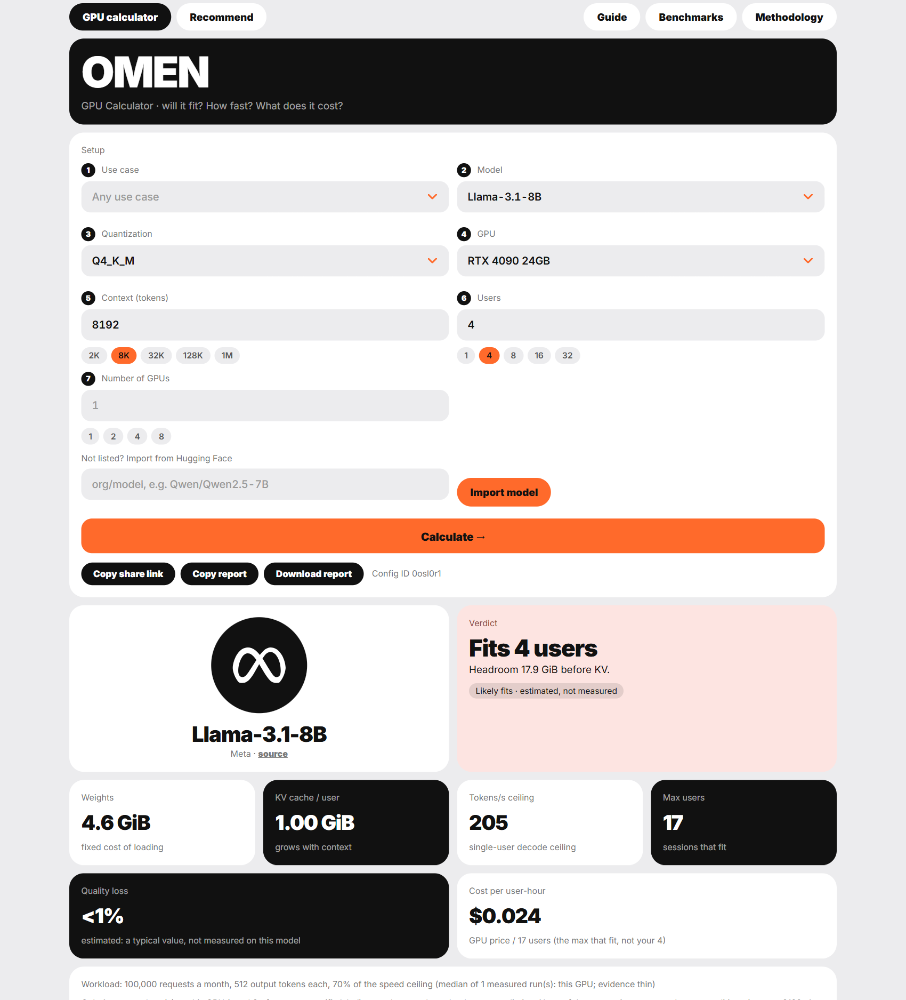
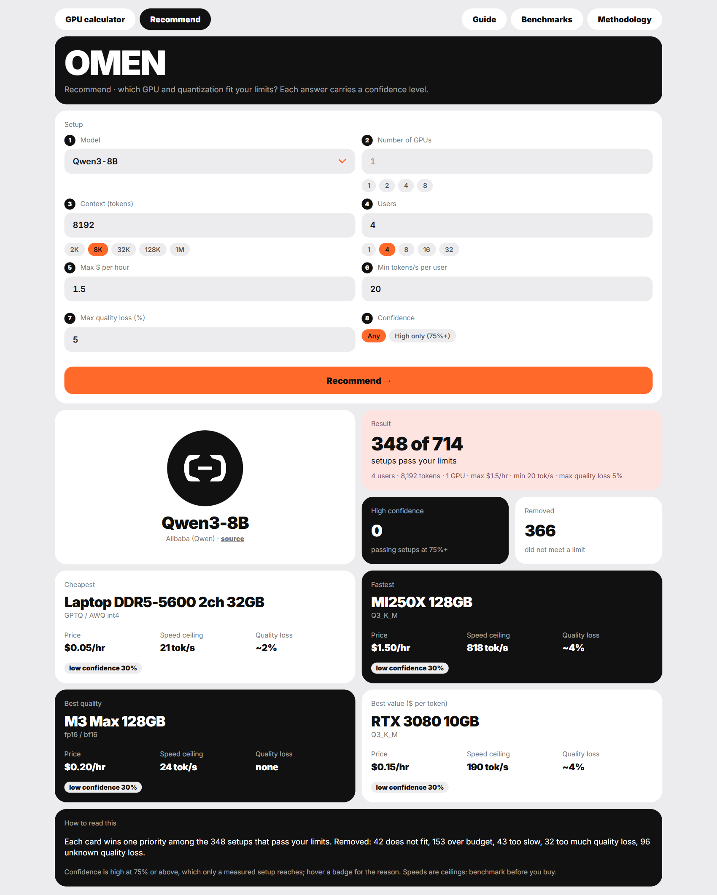
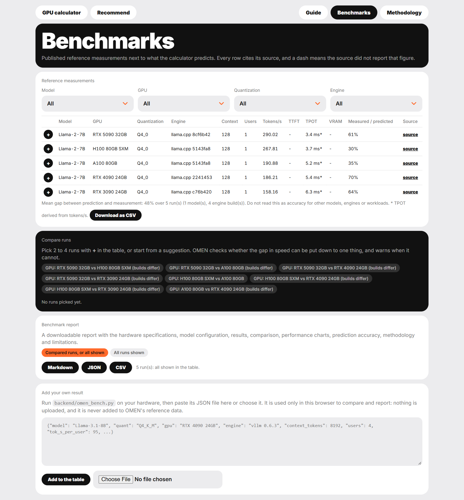
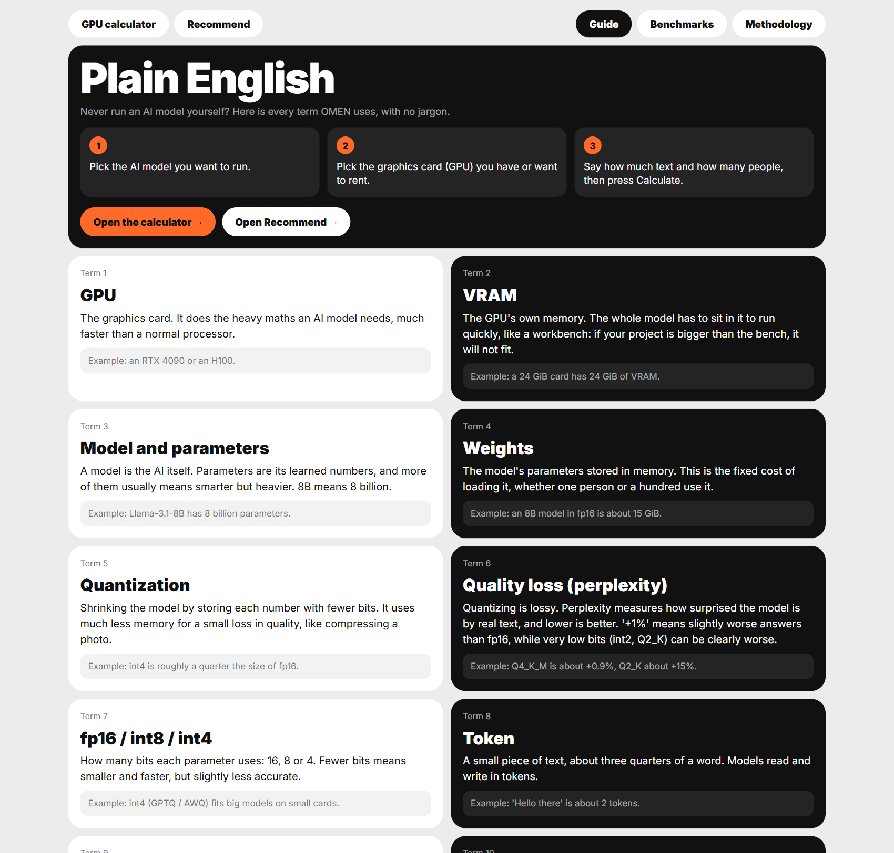
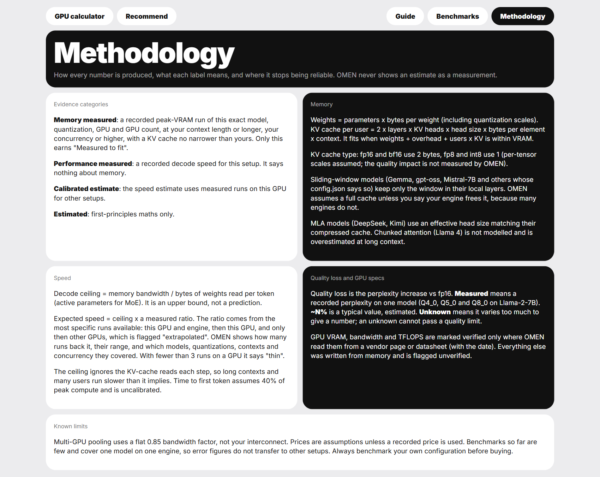

# OMEN

**Will it fit? How fast? What does it cost? And how sure are we?**

OMEN helps you decide how to run an open AI model. Pick a model, a graphics card and how many people will use it, and OMEN tells you whether it fits in memory, how fast it can run, what each user costs per hour, and which GPU and quantization to choose if you are still deciding. It runs entirely in your browser, with no install and no account.

What makes OMEN different is that it never passes off a guess as a fact. Every answer says whether it is **measured** (someone ran it and recorded the result) or **estimated** (worked out from the model's architecture and the GPU's specs), shows how much evidence stands behind it, and links the source. A speed benchmark never counts as proof that something fits in memory, and a GPU spec that has not been checked against the vendor says so.

**Live demo: https://srijithlegend.github.io/OMEN/** (served by GitHub Pages from the `main` branch)

## A tour of OMEN

OMEN has five tabs. **GPU calculator** and **Recommend** are the tools; **Guide**, **Benchmarks** and **Methodology** explain and back them up.

### GPU calculator

Pick a use case (optional), model, quantization and GPU, set the context length, the number of users and the number of GPUs, then press **Calculate**.



- **Verdict**: fits or does not fit, in four levels (measured to fit, likely fits, fits theoretically, does not fit), with the headroom left over and how many GPUs you would need if it does not fit.
- **Memory breakdown**: weights, per-user chat memory (KV cache) and overhead, drawn against your GPU's limit, with the biggest component named.
- **KV cache types**: fp16, bf16, fp8 or int8. Sliding-window models (Gemma, gpt-oss, Mistral-7B and others) are handled when you say your engine frees the unused cache.
- **Speed**: the best-case ceiling in tokens per second, an expected speed calibrated from measured runs (with how many runs back it), time to first token, and time per token.
- **Cost**: per user-hour, per 1M output tokens, and per month (billed per use or kept on 24/7).
- **Quality loss** for each quantization, labelled measured, estimated (shown as ~N%) or unknown.
- **Compare** every GPU, quantization or context length side by side, with CSV export.
- **Reports and sharing**: copy or download a full markdown fit report, copy a share link, save setups in your browser, and get a stable configuration ID for each setup.
- **Import** any public Hugging Face model, pinned to its commit. Missing fields are rejected, never guessed.

### Recommend

Not sure which GPU or quantization to choose? Tell OMEN your limits and it searches every combination for you.



| Input | Meaning |
|---|---|
| Model | The model you want to run |
| Number of GPUs | How many identical cards work together |
| Context, Users | How much text per user, and how many people at once |
| Max $ per hour | The most you will pay per hour for the whole setup (leave blank for no limit) |
| Min tokens/s per user | The slowest speed you accept for one user |
| Max quality loss (%) | The most quality you will give up to quantization |
| Confidence | **Any**, or **High only** (75% or more), which keeps just the measured setups |

OMEN tries every GPU and quantization (42 GPUs x 17 formats = 714 combinations), removes each one that breaks a limit, and only then picks winners from what is left. There is no single blended score.

- **Result card**: how many setups pass, with your limits restated. In the example above, 348 of 714 pass.
- **High confidence and Removed**: how many passing setups are well-evidenced, and how many were dropped.
- **Four pick cards**: **Cheapest** (lowest price per hour), **Fastest** (highest speed ceiling), **Best quality** (least quality loss) and **Best value** (lowest price per token of speed). Each shows the GPU, quantization, price, speed ceiling, quality loss and a confidence badge.
- **How to read this**: which limits removed how many setups.

Every pick carries a confidence level from a fixed ladder. It is not a probability, and it says nothing about memory unless the run recorded peak memory.

| Confidence | Evidence |
|---|---|
| 90% | This exact model, quantization and GPU was measured at your number of users |
| 70% | Measured, but at a different number of users |
| 50% | Estimated from measured runs of other models on that GPU |
| 30% | First-principles maths only |

High confidence means 75% or more, so only a measured setup qualifies. Speeds are ceilings: benchmark before you buy.

### Benchmarks

The published reference measurements, set next to what the calculator predicts for each.



Each row shows model, GPU, quantization, engine, context length, users, tokens/s, time to first token, time per token, VRAM and the source link. A dash means the source did not report that figure (the five bundled llama.cpp runs report only tokens/s, so their TPOT is derived and marked `*`, and none recorded memory). You can filter by model, GPU, quantization and engine, and **Download as CSV** exports the table. The five runs are Llama-2-7B in Q4_0 on llama.cpp, so the "mean gap" shown is not accuracy for other setups.

### Guide

New to running models? The Guide explains every term OMEN uses in plain English, each with an example.



There are 25 terms. They cover the basics (GPU, VRAM, parameters, weights, tokens, context length, KV cache, users), quantization (fp16 / int8 / int4, quality loss and perplexity), speed (memory bandwidth, tokens per second, decode, MoE, headroom), the difference between estimated and measured, and the Recommend tab's own vocabulary (hard limits, number of GPUs, max $ per hour, min tokens/s, max quality loss, confidence, and the four picks). Buttons at the top open the calculator or Recommend.

### Methodology

How every number is produced, what each label means, and where it stops being reliable.



It covers the four evidence categories (memory measured, performance measured, calibrated estimate, estimated), the memory formulas and KV cache types, how an expected speed is calibrated from the most specific runs available, how quality loss and GPU specs are labelled, and the known limits.

Behind the page there is also an optional [API](#the-api-backend) and a benchmark runner for measuring your own server.

## Try it

No install and no build step.

1. Download or clone this repository.
2. Open `index.html` in your browser.
3. Choose a model, quantization and GPU, set context and users, then press **Calculate**.

```bash
git clone https://github.com/SrijithLegend/OMEN.git
cd OMEN
# then open index.html in your browser
```

New to the terms? Open the **Guide** tab.

## How the numbers are worked out

| Result | Formula |
|---|---|
| Weights | parameters x bytes per parameter |
| KV cache per user | 2 x layers x KV heads x head dim x bytes per element (fp16/bf16 2, fp8/int8 1) x context. Sliding-window layers count for min(context, window) only if you say your engine frees them |
| Headroom | GPU memory - weights - overhead |
| Max users | headroom / KV cache per user (rounded down) |
| Speed ceiling | memory bandwidth / weight bytes read per token |
| Cost per user-hour | GPU price per hour / max users |

These are estimates, not benchmarks. Real speed depends on the software you use, batching and the hardware. Mixture-of-experts models use all parameters for memory but only the active ones for speed. Prices are assumptions, not quotes. The **Methodology** tab explains every label.

**Evidence.** "Measured to fit" needs a recorded peak-memory run of that exact model, quantization and GPU, at your context length or longer and your number of users or more. A speed benchmark alone never earns it.

**GPU specs.** VRAM, bandwidth and TFLOPS are marked verified only for the GPUs listed in `gpu-sources.js` (7 of 42), which were read from a vendor page or datasheet, with the date. The rest are flagged unverified.

## How far off is the speed ceiling?

The speed ceiling is a best case, and real runs land below it. Against the five published llama.cpp runs for Llama-2-7B Q4_0 (single user, 128-token context, `measured.js`):

| GPU | Measured / predicted |
|---|---|
| RTX 4090 | about 70% |
| RTX 3090 | about 64% |
| RTX 5090 | about 61% |
| A100 80GB | about 35% |
| H100 80GB SXM | about 30% |

So the ceiling reads about 1.5x too high on consumer cards and about 3x too high on datacenter cards in this case. This is five rows from one model and one quantization on four different llama.cpp builds, so do not read it as accuracy for other setups.

To turn the ceiling into an expected speed, the calculator averages only runs that match your workload: the same number of users and a context within 4x of yours, on this GPU and engine first. Runs at a different concurrency or context are never mixed in. When nothing matches it steps down (this GPU at your concurrency with a different context, then other GPUs, then the nearest hardware unmatched) and labels every step down "extrapolated". It shows how many of the runs on that hardware were used, their range, and what they covered. Only a matched same-GPU sample escapes "extrapolated", and with fewer than 3 runs it says "thin".

## Contribute a measured run

Real measurements beat estimates. If you have run a model, open the calculator for that combination and press **Submit your measured run**. It opens a pre-filled GitHub issue. Fill in the engine, tokens per second and a source link. The format is described in `runs.schema.json`, with an example in `run-template.json`.

To measure a running server, use `backend/omen_bench.py`: it works with any OpenAI-compatible server (vLLM, the llama.cpp server), records time to first token, time per token and throughput, and submits only when you pass `--consent`.

- **Tokens are counted, best method first, and the result says which**: the server's own `usage` report (exact), your `--tokenizer` applied to the generated text (exact if it matches the model), or streamed chunks (an estimate, because a chunk can hold several tokens). Estimated runs are accepted but flagged.
- **GPU memory is sampled every 0.5 s through the whole run** with `nvidia-smi`. The result carries the peak of the summed memory of the GPUs you name (`--gpu-ids 0,1`) and each GPU's own peak. It includes other processes and anything the engine pre-allocated, so it is the footprint, not the minimum.

## Contributing

- **Report a measured speed**: use **Submit your measured run** in the calculator (see above).
- **Report a measured memory use**: run the model, read the peak with `nvidia-smi --query-gpu=memory.used --format=csv`, and include it as `vram_gib` (with `gpu_count` and `kv_dtype` if they are not the defaults). Runs with peak memory are what allow a setup to be labelled "measured to fit", so these are especially welcome.
- **Verify a GPU**: read its vendor datasheet, check VRAM, bandwidth and FP16 TFLOPS, update `gpus.js` / `gpu-compute.js`, and add an entry to `gpu-sources.js` with the source URL, date and the fields you checked.
- **Fix or add a model**: add its Hugging Face repo to `scripts/gen-models.js` and run `node scripts/gen-models.js`. Do not edit `models.js` by hand. Models are only included when their `config.json` and parameter count can be read.
- Run `node test.js` and `cd backend && python -m pytest` before opening a pull request. After changing any data file, run `node scripts/export-catalog.js` so the API stays in sync.

## Project layout

| File | Purpose |
|---|---|
| `index.html` | The whole app (page, styles, logic) |
| `fit.js`, `intel.js` | The fit, workload, recommendation, calibration and evidence maths |
| `models.js`, `quants.js`, `gpus.js`, `gpu-compute.js`, `memtypes.js`, `usecases.js` | Data tables |
| `gpu-sources.js` | Source URL, date and checked fields for each GPU whose specs were verified |
| `measured.js` | Published measured runs |
| `runs.schema.json`, `run-template.json` | Format for a measured run |
| `scripts/gen-models.js` | Rebuilds `models.js` from each model's Hugging Face `config.json` |
| `scripts/export-catalog.js` | Exports the data tables to `backend/app/catalog.json` |
| `test.js` | Checks the page maths |
| `backend/` | The optional API and benchmark runner |

## Tests

```bash
node test.js                    # page maths
cd backend && python -m pytest  # API, 44 tests
```

GitHub Actions runs both on every push, and runs the API tests against PostgreSQL as well as SQLite.

`backend/tests/test_e2e_benchmark_lifecycle.py` follows one benchmark through the whole path: submit, pending, community, verified, the public explorer, and the speed estimate. It checks that only a verified run changes the estimate, and that pending, community, rejected and later-rejected runs never do.

## Limits

Treat results as a starting point, then measure. OMEN defaults to an fp16 KV cache, counts a flat 85% bandwidth scaling for multiple GPUs rather than modelling your interconnect, and does not model chunked attention (Llama 4), so those models are overestimated at long context. Time to first token assumes 40% of peak compute and is not calibrated. The benchmark dataset is small and covers one model on one engine, so expected speeds carry the caveats the calculator shows beside them.

## License

MIT, see `LICENSE`.

## The API (backend/)

The web page does not use this server: everything in it, including the **Recommend** tab, runs in the browser. The server is a separate, optional service for programs that want the same numbers over HTTP. It is a FastAPI app sharing the page's data (`node scripts/export-catalog.js` regenerates `backend/app/catalog.json`).

```bash
cd backend
pip install -r requirements.txt
python -m pytest                                # 44 tests
python -m uvicorn app.main:app --port 8787      # docs at http://localhost:8787/docs
```

Set the reviewer key first if you want to verify runs or add prices. Git Bash / Linux / macOS: `export OMEN_ADMIN_KEY=choose-a-secret`. Windows PowerShell: `$env:OMEN_ADMIN_KEY="choose-a-secret"`. If you see "address already in use", another program has that port: pick another with `--port`.

| Endpoint | What it does |
|---|---|
| `GET /api/v1/models`, `/models/{id}`, `/gpus`, `/gpus/{id}`, `/quantizations` | Catalog lookup. GPUs carry `spec_status` and `spec_source`; quantizations carry `quality_loss_kind` |
| `POST /api/v1/estimate/memory` | Weights, KV cache, overhead, headroom, four-level fit status. Takes `kv_dtype` (fp16, bf16, fp8, int8), `sliding_cache`, `engine`. `evidence` separates `memory_measured`, `performance_measured` and `calibrated_on_this_gpu` |
| `POST /api/v1/estimate/performance` | Decode ceiling, TTFT, TPOT, end to end. `calibration` reports tier (this GPU and engine ... other GPUs), run count, range, coverage and caveats; `decode_tok_s_range` appears when 2+ runs support it. `null` where data is missing |
| `POST /api/v1/workloads/simulate`, `/cost/estimate` | Capacity, $ per 1M tokens, monthly cost, cloud vs self-hosted, break-even |
| `GET /api/v1/prices`, `POST /api/v1/prices` | Cloud price catalog (AWS, Google Cloud, Azure, Oracle, CoreWeave, Lambda, RunPod, Vast.ai, Paperspace, DigitalOcean, Together AI). Reviewer-entered, each with a source URL and date, append-only. `/cost/estimate` takes `provider` and `pricing_model` to use it. The catalog starts empty, so costs use assumed prices until prices are entered |
| `POST /api/v1/configurations/compare` | Side by side; warns when workloads differ |
| `POST /api/v1/recommendations` | Hard limits first, then one pick per priority. Each pick carries a `confidence` (0.9 measured at your concurrency, 0.7 measured at another, 0.5 calibrated on other models on that GPU, 0.3 first-principles). **High confidence means 0.75 or above**, so only a measured setup qualifies. `min_confidence: 0.75` drops everything else. The score is a fixed ladder, not a probability |
| `POST /api/v1/benchmarks/submit`, `GET /benchmarks`, `GET /benchmarks/{id}`, `POST /benchmarks/{id}/verify`, `POST /benchmarks/{id}/reject` | Consent-gated submission (10 per client per hour, every field bounded, 64 KB body cap), background validation, duplicate checks on the whole setup (model, quantization, GPU and count, KV type, engine, context, users) and physics checks (including `vram_gib` vs the GPU and the weights). Reviewers verify or reject with required notes, the evidence they checked and (for rejection) a reason; each action is an append-only audit row (who, when, before and after status) shown by `GET /benchmarks/{id}`, the submitted data and source URL are never altered, and a rejected run leaves calibration immediately. Only sourced and verified runs count as evidence or calibration; `vram_gib`, `gpu_count` and `kv_dtype` are what make a run count for memory |
| `POST /api/v1/keys`, `/workspaces/{project}/analyses`, `/workspaces/{project}/changes` | Hashed API keys with a rate limit, private saved analyses, re-run and report material changes |
| `GET /metrics` | Prometheus metrics |

The database is SQLite by default. `OMEN_DB=postgresql+psycopg://...` selects PostgreSQL, and `docker compose up --build` in `backend/` starts the API, PostgreSQL and Prometheus. If you have a database file from an older version, delete it: the schema gained columns.

**Reviewers.** `OMEN_REVIEWER_KEYS="alice:key1,bob:key2"` gives each reviewer their own key and the audit trail records the key owner. The shared `OMEN_ADMIN_KEY` still works, but the reviewer then has to name themselves and is recorded as "declared, shared admin key".

**Production.** Set `OMEN_ENV=production`: the server then refuses to start unless `OMEN_CORS` lists your site's origin (`*` is only the local default). Compose requires `OMEN_ADMIN_KEY`, `POSTGRES_PASSWORD` and `OMEN_CORS`, restarts services, and keeps data in the `pgdata` volume; back it up with `docker compose exec db pg_dump -U omen omen > omen-backup.sql`. Behind a proxy, run uvicorn with `--proxy-headers` so the submission rate limit sees real client addresses (it is per process; use Redis if you run several workers).

**Tested so far.** SQLite: 44 backend tests and all page tests. PostgreSQL: the same suite runs in GitHub Actions. Docker Compose and a real deployment have not been tested yet: do that before launch.
