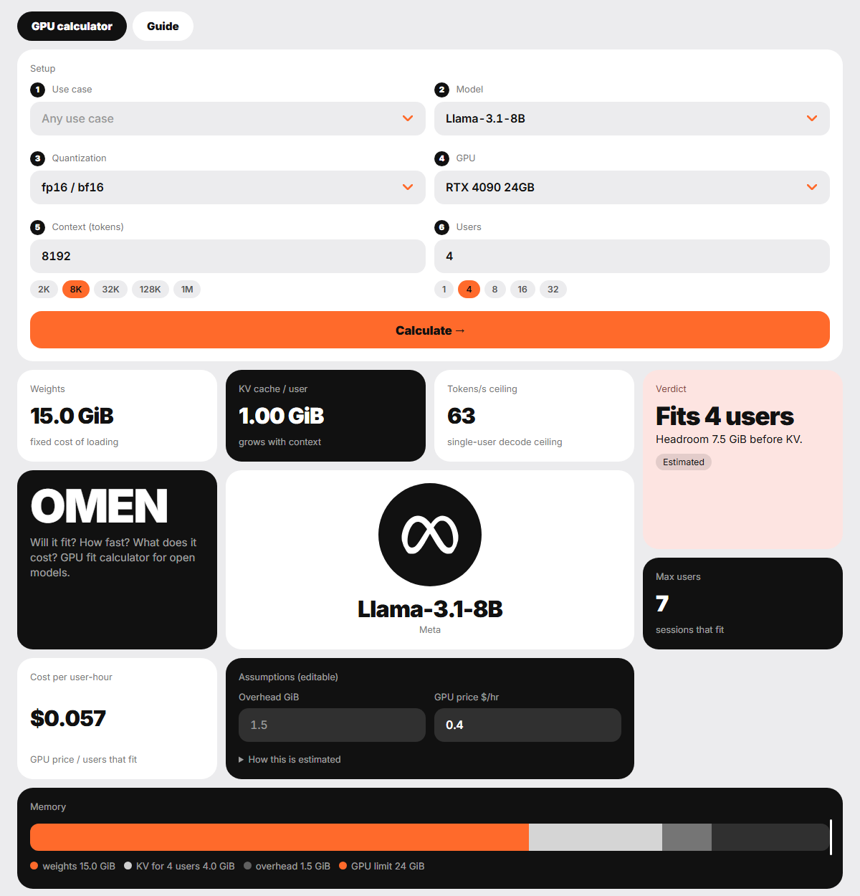

# OMEN

**Will it fit? How fast? What does it cost?**
OMEN is a GPU fit calculator for open AI models. Pick a model, a graphics card and how many people will use it, and OMEN tells you whether it fits in memory, roughly how fast it will run, and what each user costs per hour.



## What you get

- **A clear verdict**: fits or does not fit, with the headroom left over (and how many GPUs you would need if it does not fit).
- **Memory breakdown**: weights, per-user chat memory (KV cache) and overhead, drawn against your GPU's limit.
- **Speed ceiling**: the best-case tokens per second for one user.
- **Cost per user-hour**: the GPU price divided by the users that fit.
- **Plenty of choices**: open models from Meta, Mistral, Qwen, Google, Microsoft, DeepSeek, OpenAI and others, filterable by use case (code, vision, finance, math and reasoning), many quantization formats, and a list of GPUs.
- **A plain-English Guide tab** that explains every term (VRAM, quantization, KV cache and more) for people new to running models.
- **Shareable links**: your setup is stored in the page URL.

## Try it

No install and no build step.

1. Download or clone this repository.
2. Open `index.html` in your browser.
3. Choose a model, quantization and GPU, set context and users, then press **Calculate**.

```bash
git clone https://github.com/SrijithLegend/OMEN.git
cd OMEN
# then open index.html in your browser
```

New to the terms? Open the **Guide** tab at the top of the page.

## How the numbers are worked out

| Result | Formula |
|---|---|
| Weights | parameters x bytes per parameter |
| KV cache per user | 2 x layers x KV heads x head dim x 2 bytes x context |
| Headroom | GPU memory - weights - overhead |
| Max users | headroom / KV cache per user (rounded down) |
| Speed ceiling | memory bandwidth / weight bytes read per token |
| Cost per user-hour | GPU price per hour / max users |

These are estimates, not benchmarks. Real speed depends on the software you use, batching and the hardware. Mixture-of-experts models use all parameters for memory but only the active ones for speed. GPU specs come from vendor datasheets and prices are assumptions, not quotes.

## Contribute a measured run

Real measurements beat estimates. If you have run a model, open the calculator for that combination and press **Submit your measured run**. It opens a pre-filled GitHub issue. Fill in the engine, tokens per second and a source link. The format is described in `runs.schema.json`, with an example in `run-template.json`.

## Project layout

| File | Purpose |
|---|---|
| `index.html` | The whole app (page, styles, logic) |
| `fit.js` | The fit calculation |
| `scripts/gen-models.js` | Rebuilds `models.js` from each model's Hugging Face `config.json` (`node scripts/gen-models.js`) |
| `models.js`, `quants.js`, `gpus.js`, `memtypes.js`, `usecases.js` | Data tables |
| `measured.js` | Community-measured runs |
| `test.js` | Checks the calculation: `node test.js` |

## Tests

```bash
node test.js
```

## Limits

OMEN assumes an fp16 KV cache and ignores multi-GPU interconnect losses. The multi-GPU counts shown are minimums. Treat results as a starting point, then measure.
